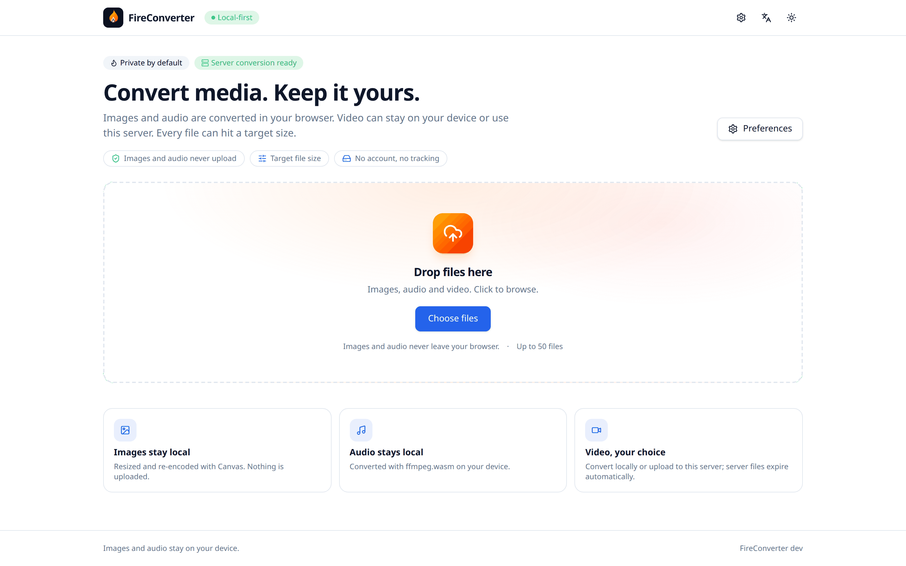
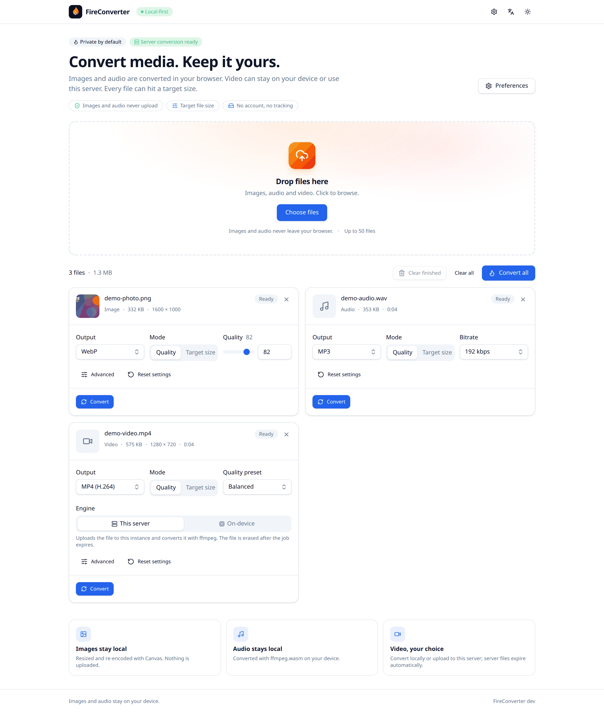
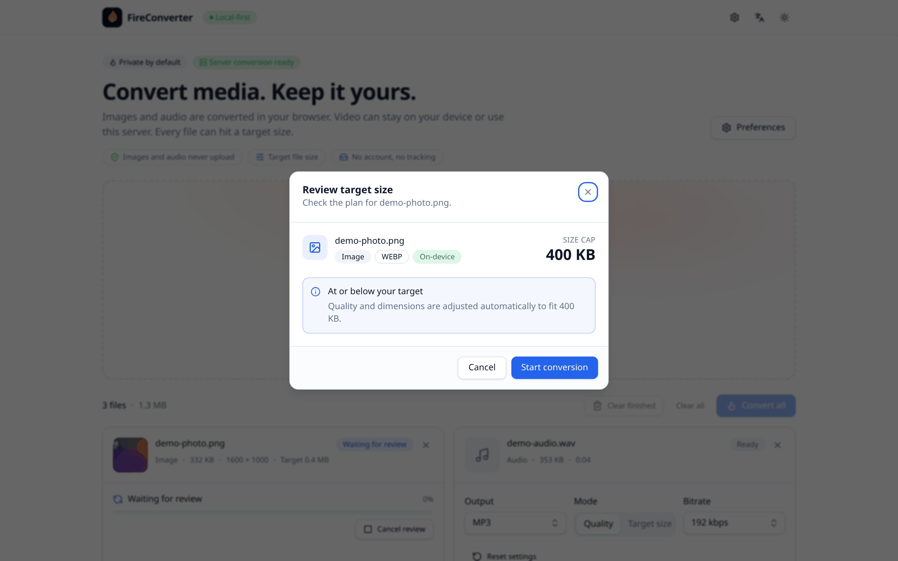
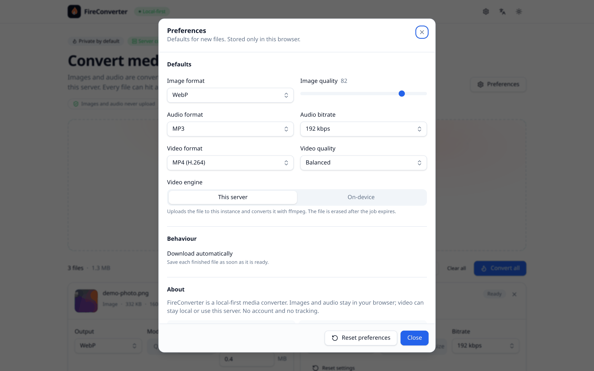
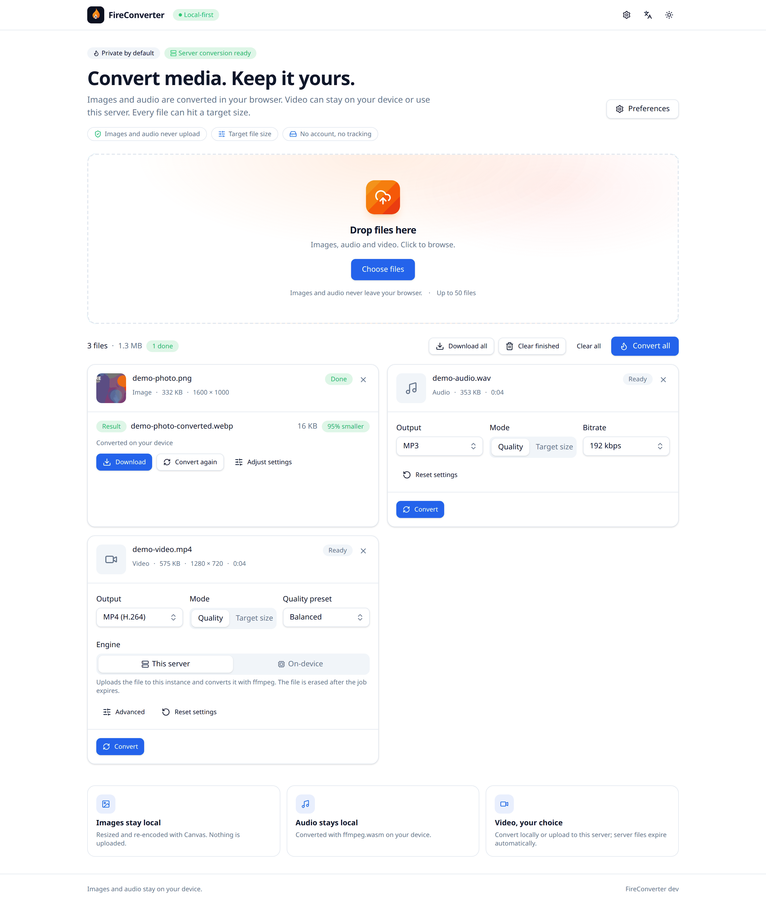

<p align="center">
  
</p>
<h1 align="center">FireConverter</h1>
<p align="center"><strong>Private, local-first media conversion with target file sizes.</strong></p>

<p align="center">
  <a href="#quick-start">Quick start</a> ·
  <a href="#screenshots">Screenshots</a> ·
  <a href="#conversion-matrix">Formats</a> ·
  <a href="#target-size">Target size</a> ·
  <a href="docs/api.md">API</a> ·
  <a href="docs/configuration.md">Configuration</a>
</p>



## Why FireConverter

Most converters upload everything to a server. FireConverter follows VERT's
model instead: **images and audio are converted in your browser**, and video can
stay local or use the server. The difference is that every category can hit a
**target file size** you choose — not just a quality slider.

- **Images** — Canvas, no upload, resize and target-quality search.
- **Audio** — bundled ffmpeg.wasm, no upload, target bitrate from duration.
- **Video** — ffmpeg.wasm **or** server ffmpeg, two-pass target-size encoding,
  progress, cancel, automatic TTL cleanup.
- **Single binary** — Go server with the Vue SPA and ffmpeg.wasm embedded.
- **No accounts, no tracking, no donation prompts.**

## Screenshots

| Queue and per-file settings | Target-size review |
| :--: | :--: |
|  |  |

| Preferences | Finished conversion |
| :--: | :--: |
|  |  |

## Conversion matrix

| Category | Engine | Accepted inputs | Outputs |
| :-- | :-- | :-- | :-- |
| Image | Browser (Canvas) | PNG, JPEG, WebP, AVIF, GIF*, BMP, SVG, ICO | WebP, JPEG, PNG, AVIF† |
| Audio | Browser (ffmpeg.wasm) | MP3, WAV, FLAC, OGG/Opus, AAC/M4A, AIFF, AC3, MP2, WMA, ALAC | MP3, M4A, AAC, OGG, Opus, FLAC, WAV |
| Video | Browser (ffmpeg.wasm) | MP4, MKV, MOV, WebM, AVI, M4V, TS/M2TS, FLV, WMV, 3GP, OGV, MPG | MP4, WebM, MKV, MOV, GIF, MP3 |
| Video | Server (ffmpeg) | Same as above | MP4, WebM, MKV, MOV, GIF, MP3 |

\* Animated GIF is flattened to its first frame.
† AVIF encoding is feature-detected; the option is hidden when the browser
cannot encode it.

The server API also accepts audio uploads, but the UI intentionally converts
audio on-device. Images are always local. See [docs/formats.md](docs/formats.md)
for codecs and target-size support.

## Target size

Choose **Target size**, enter a value in MB, and press Convert. FireConverter
shows a review dialog with the plan before encoding:

- **Images** binary-search the encoder quality, then downscale if the lowest
  quality is still too large.
- **Audio** derives the bitrate from the duration (`target × 8 / duration`).
- **Video** reserves the audio track, gives the rest to the video encoder and
  runs two passes. The server verifies the result and retries once if the muxer
  overshoots. Local video does the same verification in the browser.
- Lossless outputs (WAV/FLAC) and GIF do not offer target size.

The complete math and limits are in [docs/target-size.md](docs/target-size.md).

## Quick start

### Docker (recommended)

```bash
cd docker
cp .env.example .env
docker compose up --build -d
```

Open <http://localhost:3069>. The image includes ffmpeg; no other service is
required.

### From source

Prerequisites: Go 1.24+, Node.js 22+, and optionally `ffmpeg`/`ffprobe` for
server-side video.

```bash
cd web
npm ci
npm run build
cd ..
APP_PORT=3000 go run ./cmd/server
```

Open <http://localhost:3000>. The explicit `APP_PORT=3000` matters if
`docker/.env` exists: that file sets the compose host port (3069), while Vite’s
dev proxy expects the source server on 3000. Without ffmpeg the UI still performs
every local conversion and marks server video as unavailable.

## Configuration

The most useful variables (full list in [docs/configuration.md](docs/configuration.md)):

| Variable | Default | Meaning |
| :-- | :-- | :-- |
| `APP_PORT` | `3000` | HTTP listen port; with compose, `docker/.env` sets the published host port (default `3069`) while the container listens on `3000` |
| `WORK_DIR` | `/tmp/fireconverter` | Per-job temporary storage |
| `MAX_UPLOAD_MB` | `2048` | Server upload cap |
| `MAX_DURATION_SECONDS` | `21600` | Longest server video (6 h) |
| `JOB_TTL_MINUTES` | `60` | How long a finished job is downloadable |
| `MAX_CONCURRENT_JOBS` | `2` | ffmpeg processes in parallel |
| `MAX_JOBS_PER_IP` | `4` | Active jobs per client |
| `TARGET_SIZE_MAX_MB` | `4096` | Target-size ceiling |
| `APP_TRUST_PROXY` | `false` | Trust `X-Forwarded-For` for the per-IP cap |

## Documentation

- [Usage](docs/usage.md) — the workflow, engines, target-size review and troubleshooting.
- [Formats](docs/formats.md) — inputs, outputs, codecs and target-size support.
- [Target size](docs/target-size.md) — the math, review step and precision.
- [API](docs/api.md) — upload, confirm, poll, cancel and download.
- [Configuration](docs/configuration.md) — every environment variable and reverse-proxy notes.
- [Development](docs/development.md) — build, test, screenshots and project layout.
- [Architecture](docs/architecture.md) — how the local engines and the Go server fit together.
- [Security](docs/security.md) — threat model, CSP, limits and deployment guidance.
- [i18n](docs/i18n.md) — the seven catalogs, RTL and the parity checker.

## Development

```bash
# terminal 1 — API
go run ./cmd/server

# terminal 2 — Vite with HMR
cd web
npm ci
npm run dev
```

```bash
# full validation
cd web && npm run build
cd .. && go test ./...

# Docker
docker build -t fireconverter .

# screenshots (needs Chrome + a running instance)
cd web && npm run screenshots
```

The demo fixtures live in `web/scripts/fixtures`. To regenerate the small video:

```bash
docker run --rm --user "$(id -u):$(id -g)" \
  -v "$PWD/web/scripts/fixtures:/out" \
  --entrypoint ffmpeg fireconverter:test \
  -y -f lavfi -i 'testsrc2=size=320x180:rate=15' \
  -f lavfi -i 'sine=frequency=660:sample_rate=44100' -t 1 \
  -c:v libx264 -preset ultrafast -pix_fmt yuv420p -c:a aac -b:a 64k \
  -shortest /out/demo-video-small.mp4
```

## Security

Images and audio never leave the browser. Video is uploaded only when the
server engine is selected; it is stored in `WORK_DIR`, erased after
`JOB_TTL_MINUTES`, and served only through an unguessable job ID. The server
runs ffmpeg without a shell, caps uploads, duration, concurrency and per-IP
jobs, and sets a strict Content-Security-Policy. There is no built-in login:
put the instance behind an authenticating reverse proxy before exposing it to
the internet. See [docs/security.md](docs/security.md).

## License

MIT — see [LICENSE](LICENSE). FireConverter is an independent implementation
inspired by [VERT.sh](https://vert.sh); no VERT source code is included.

<!-- buttons -->
[](https://github.com/ivancarlosti/fireconverter/stargazers)
[](https://github.com/sponsors/ivancarlosti)
[](https://github.com/sponsors/ivancarlosti)
[](https://github.com/ivancarlosti/fireconverter/releases)
[](https://github.com/ivancarlosti/fireconverter/pulse)
[](https://github.com/ivancarlosti/fireconverter/issues)  
[](LICENSE)
[](https://github.com/ivancarlosti/fireconverter/commits)
[](https://github.com/ivancarlosti/fireconverter/security)
[](https://github.com/ivancarlosti/fireconverter?tab=coc-ov-file)
<!-- endbuttons -->

<!-- footer -->
---

## 🧑‍💻 Consulting and technical support
* For personal support and queries, please submit a new issue to have it addressed.
* For commercial related questions, please [**contact me**][ivancarlos] for consulting costs.

[cc]: https://docs.github.com/en/communities/setting-up-your-project-for-healthy-contributions/adding-a-code-of-conduct-to-your-project
[contributing]: https://docs.github.com/en/articles/setting-guidelines-for-repository-contributors
[security]: https://docs.github.com/en/code-security/getting-started/adding-a-security-policy-to-your-repository
[support]: https://docs.github.com/en/articles/adding-support-resources-to-your-project
[it]: https://docs.github.com/en/communities/using-templates-to-encourage-useful-issues-and-pull-requests/configuring-issue-templates-for-your-repository#configuring-the-template-chooser
[prt]: https://docs.github.com/en/communities/using-templates-to-encourage-useful-issues-and-pull-requests/creating-a-pull-request-template-for-your-repository
[funding]: https://docs.github.com/en/articles/displaying-a-sponsor-button-in-your-repository
[ivancarlos]: https://ivancarlos.me
